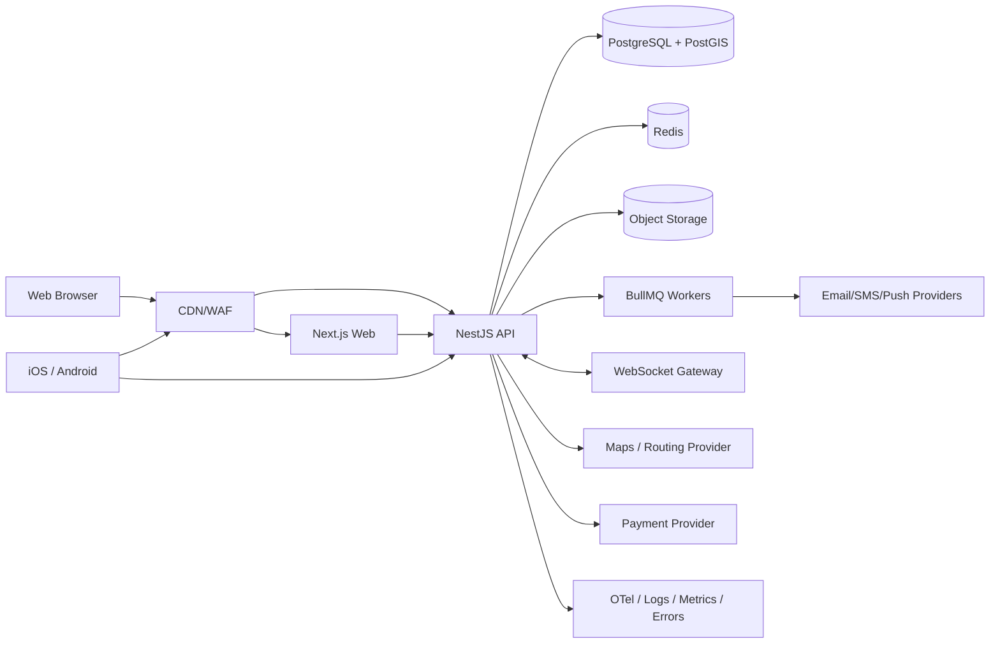

# 02 — System Architecture

## High-level architecture

## Backend modules

Keep a modular monolith initially, with explicit boundaries that can be separated later:

- Identity/Profile
- Vehicles
- Places/Providers
- Search/Geo
- Fuel & Live Status
- Routing/Optimization
- Favorites/Offline Packs
- Contributions/Moderation
- Reviews/Media
- Rewards
- Bookings
- Payments
- Roadside Dispatch
- Chat/Realtime
- Notifications/Alerts
- Emergency Contacts
- Property Listings
- Inspection Bookings
- Admin/Operations
- Audit/Compliance

Each module owns its entities/repositories/application services/controllers. Cross-module calls go through public application interfaces or domain events; do not import internal repositories across modules.

## API style

- REST JSON over HTTPS under `/v1`
- OpenAPI is generated and treated as a contract
- WebSocket for dispatch/chat/live-location events only when realtime is materially useful
- Webhooks for payment/provider callbacks with signature verification and replay protection
- Cursor pagination for feeds; bounded page/limit for admin tables
- RFC 7807-style problem details for errors
- idempotency keys for retry-prone create/mutate operations

## Geospatial design

Use PostGIS `geography(Point, 4326)` for place coordinates and spatial indexes. Common patterns:

- radius query with `ST_DWithin`
- distance sort with `ST_Distance`
- viewport query by bounding box/polygon
- server-side clustering or tile aggregation for dense maps
- route corridor query to find services within N meters of a route geometry

Never download all service points and filter only on the client.

## Realtime design

Roadside dispatch and chat use authenticated WebSocket channels. Requirements:

- authorize every channel join
- server is authoritative for state
- events contain sequence number / version
- client reconnect resumes from last event where feasible
- duplicate events are idempotently handled
- presence is best-effort, not an authorization source
- location updates are rate-limited and expire

## Caching

Use Redis for:

- rate-limit counters
- hot nearby-search cache by normalized geo bucket/filter signature
- short-lived route/price optimization cache
- distributed idempotency locks
- queue storage
- websocket presence metadata

Do not cache personalized sensitive emergency content in shared keys.

## Media

Direct client uploads use short-lived signed URLs. API validates upload intents and post-upload metadata. A background worker performs:

1. MIME/magic-number validation
2. size/dimension validation
3. malware scan where applicable
4. EXIF stripping or controlled retention
5. thumbnail generation
6. moderation queue submission when required

## Environments

- local
- test/CI
- staging
- production

Use separate accounts/projects or strong resource isolation. Production data must never be copied to local/test without anonymization.
